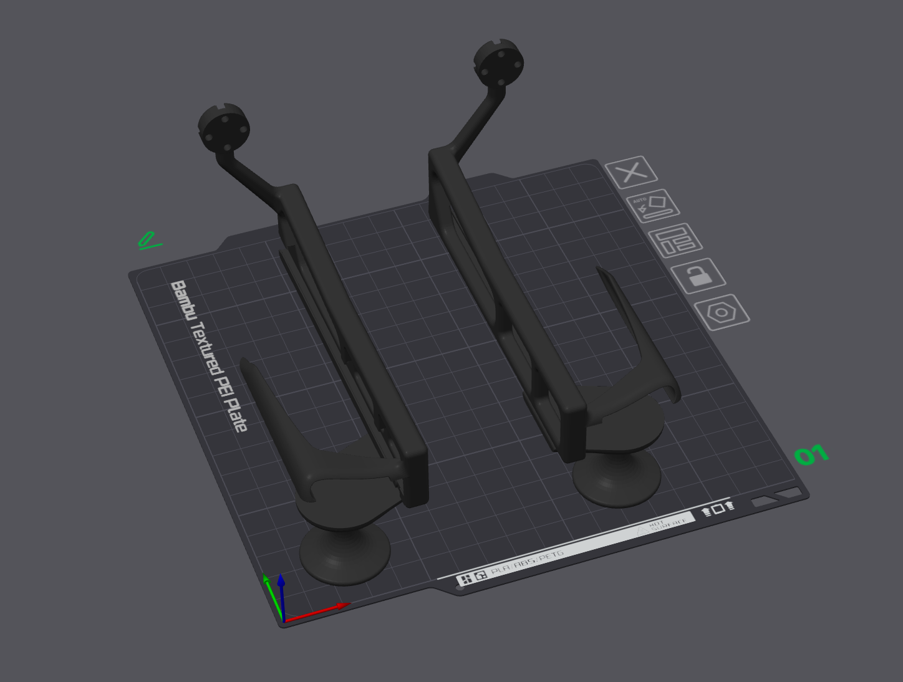
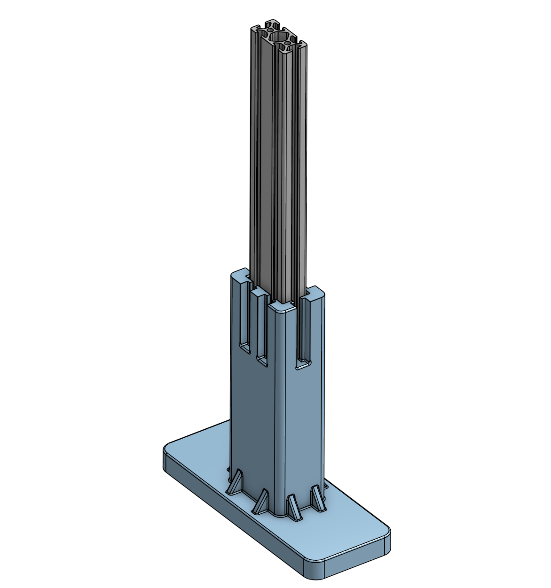
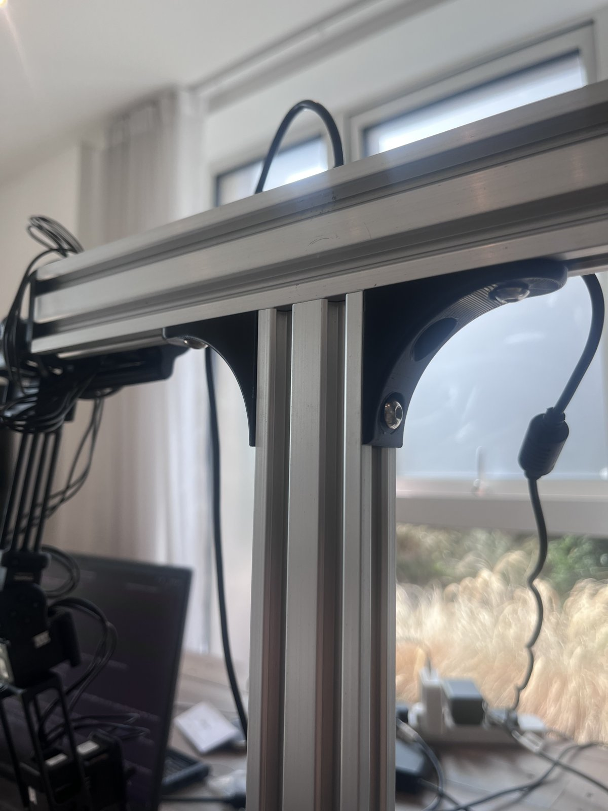
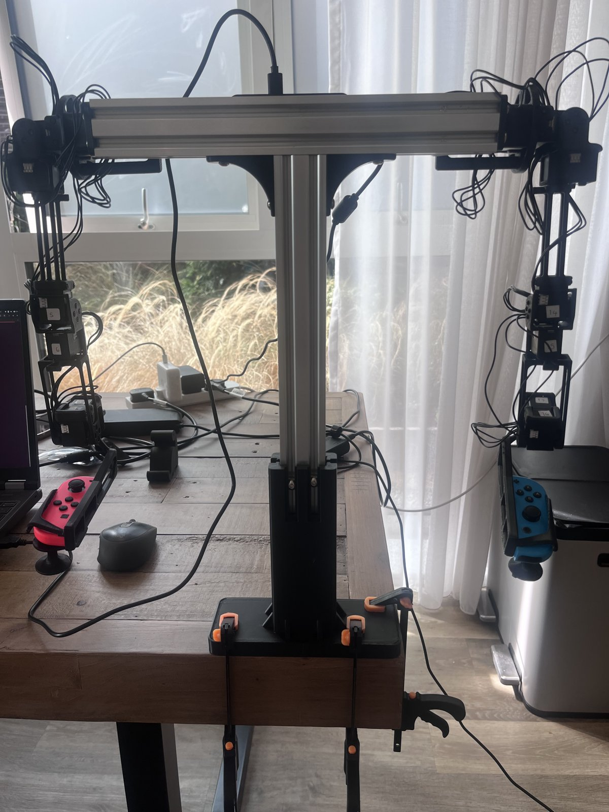

# JoyLo Build Guide (7-DoF, UK parts)

How we built the physical [JoyLo](https://behavior.stanford.edu/behavior_components/joylo.html) teleoperation rig used in our physical teleoperation experiments. The bill of materials is for sourcing parts in the UK. The rig is two 7-DoF arms, about **£625** in total.

**Contents:** [Bill of materials](#bill-of-materials) · [Printing](#printing) · [Mounting to the desk](#mounting-to-the-desk) · [Mounting the arms](#mounting-the-arms-to-the-desk-mount)

> **Reference material.** The official guides are a bit confusing and outdated in places, but their images are useful for seeing how the joints should be configured:
> [reference positions](https://behavior.stanford.edu/behavior_components/joylo.html#reference-positions) and
> [7-DoF guide](https://behavior-robot-suite.github.io/docs/sections/joylo/joylo_7dof.html).

## Bill of materials

| Part | Model | Qty | Unit | Total | Buy |
| --- | --- | ---: | ---: | ---: | --- |
| Joint motor | DYNAMIXEL XL330-M288-T | 18 | £22.67 | £408.06 | [Robotis](https://robotis.co.uk/robotis-dynamixel-xl330-m288-t.html) |
| Joystick | Nintendo Joy-Con | 1 | £69.99 | £69.99 | [Nintendo](https://store.nintendo.com/en-gb/nintendo-switch-neon-red-joy-con-l-and-neon-blue-joy-con-r-controller-set-000000000002510166) |
| Joy-Con charging dock | - | 1 | £14.99 | £14.99 | [Argos](https://www.argos.co.uk/product/6836577) |
| USB comms for motors | Dynamixel U2D2 | 1 | £29.50 | £29.50 | [Robotis](https://robotis.co.uk/robotis-u2d2.html) |
| Power hub | U2D2 Power Hub Board Set | 1 | £16.33 | £16.33 | [Robotis](https://robotis.co.uk/robotis-u2d2-phb-set.html) |
| Hinge frames and idlers | Dynamixel FPX330-H101, 4 pcs set | 1 | £8.00 | £8.00 | [Robotis](https://robotis.co.uk/fpx330-h101-4pcs-set.html) |
| 5V DC power supply | 5V 4A adapter (LeTaoXing) | 1 | £11.00 | £11.00 | [Amazon](https://www.amazon.co.uk/dp/B0BN3W5T6J) |
| Printer filament | eSUN PLA+ 1.75 mm | 1 | £26.00 | £26.00 | [Amazon](https://www.amazon.co.uk/dp/B09Q5YWLN1) |
| Aluminium extrusions | 2x 2040 V-slot, 300 mm | 1 | £12.59 | £12.59 | [Amazon](https://www.amazon.co.uk/dp/B0FG2QRVCW) |
| M5 self-tapping screws | - | 1 | £5.09 | £5.09 | [Amazon](https://www.amazon.co.uk/dp/B0FWJZ1BJ9) |
| M5 button-head screws and T-slot nuts | - | 1 | £5.19 | £5.19 | [Amazon](https://www.amazon.co.uk/dp/B0FWR1K6W5) |
| Desk clamps | - | 1 | £18.00 | £18.00 | [Amazon](https://www.amazon.co.uk/gp/product/B07ZTVY1PM) |
| | | | **Total** | **£624.74** | |

**Notes**

- **Motors:** 9 per arm. Buy extra if you want spares.
- **Power supply:** it must fit the U2D2 Power Hub board, which expects an SMPS DC connector (2.5 mm ID / 5.5 mm OD, [centre positive](https://emanual.robotis.com/docs/en/parts/interface/u2d2_power_hub/)).
- **Extrusions:** you may not be able to get these depending on where you live, but try to get this one. The mount is designed for it, and the pack contains two.
- **Desk clamps:** check the size you need for your desk.

## Printing

The design files for the 7-DoF arms are in the BRS repo: [`joylo_v2_7dof_arm`](https://github.com/behavior-robot-suite/brs-ctrl/tree/main/hardware/joylo_v2_7dof_arm).

The only part you need to mirror is the one that interfaces with the Joy-Con controllers (`ljc.obj`).

  

### Bambu Lab A1 Mini prints

We split the parts into left-arm and right-arm print jobs. Download the `.3mf` files:

| Arm | Print 1 (UK and US) | Print 2, UK | Print 2, US |
| --- | --- | --- | --- |
| **Left** | [left-print1](joylo/prints/left-print1.3mf) | [left-print2-UK](joylo/prints/left-print2-UK.3mf) | [left-print2-US](joylo/prints/left-print2-US.3mf) |
| **Right** | [right-print1](joylo/prints/right-print1.3mf) | [right-print2-UK](joylo/prints/right-print2-UK.3mf) | [right-print2-US](joylo/prints/right-print2-US.3mf) |

> [!NOTE]
> The aluminium extrusions and bolts that are easy to find in the UK differ from those in the US, so we redesigned the mounting parts to fit standard UK extrusions.
>
> - Print 1 is the same for the UK and the US.
> - Print 2 comes in a UK and a US version. It also contains the Joy-Con part, which did not fit on the print bed of the other job.
> - The base mount we designed only works with the UK aluminium extrusions.

## Mounting to the desk

We use a 3D-printed base mount. It **only works with the 2040 aluminium extrusions**.

  

- **STL:** [`2040_base_mount.stl`](joylo/prints/2040_base_mount.stl). We printed it with 50% infill and it was stable.
- **Source:** [OnShape document](https://cad.onshape.com/documents/c737ba14d61129570893be8b/w/4cf0644d3802889458bb4979/e/a0c56692f96395e048a32bdb), if you want to modify it. A free OnShape account is enough.

### Background

The extrusions we ordered from Amazon come as a 2-pack. To avoid ordering more parts we designed a base mount that uses the second one.

We first tried a [webcam stand](https://www.amazon.co.uk/dp/B08RB2LYM9), but the M5 screws needed for the extrusions did not match its US 1/4" thread. An adapter stripped the threads.

## Mounting the arms to the desk mount

We used [this 90-degree extrusion mount from MakerWorld](https://makerworld.com/en/models/2134836-2020-extrusion-corner-or-wall-90-degrees-mount), which worked well.

  
  

> [!TIP]
> Use shorter M5 button-head screws. The 10 mm ones from the ordered pack were a bit too long: they hit the base of the V-slot before making full contact with the 3D-printed part.
